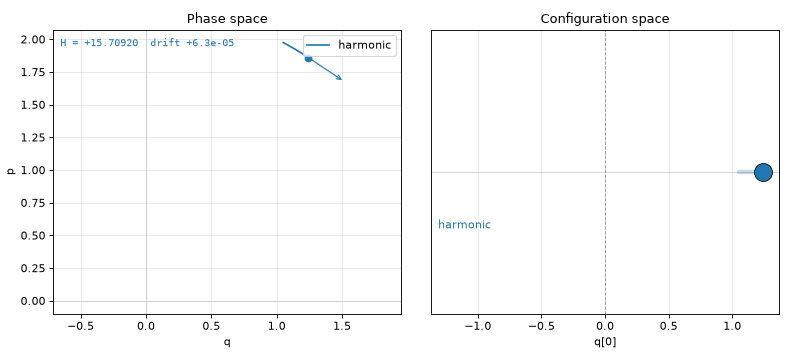
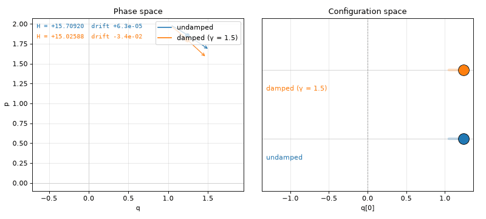
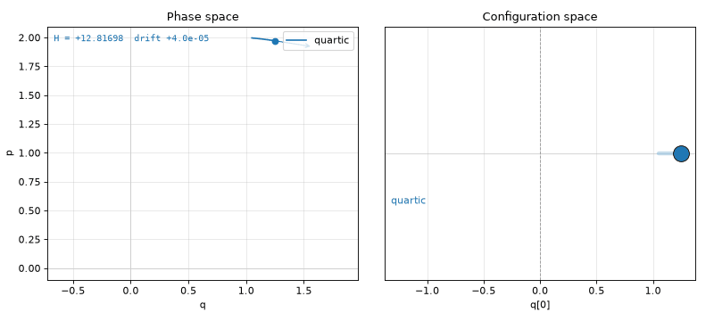
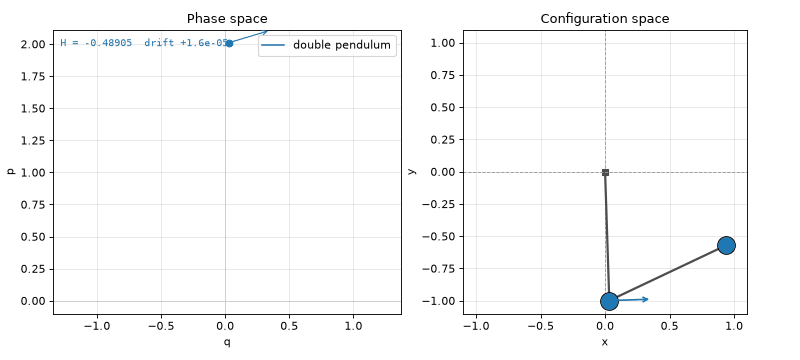

# Hamiltonian visualizer with Torch

This is a tool that uses Torch as an Autograd engine to visualize arbitrary hamiltonians.

I was trying to find a way to visualize arbitrary Hamiltonians, and was not able to find something online.

Since I work with Deep Learning, this started to look a lot like a nail for my hammer.
It's certainly not the most efficient way to do this, but its generality given its simplicity is quite appealing.

Very work in progress.

AI was used for the visualization code, since I don't want to bother with matplotlib.

## Gallery

Every clip below is the real visualizer, slowed down to 0.4× real time (0.6× for the pendulum) so it's easy to follow. On the left is **phase space** (`q` against `p`), with
the field's arrow at the current state and a readout of `H` and how far it has drifted from its starting value. On the
right is **configuration space**: what the system actually looks like at each instant, with arrows for velocity.

### Harmonic oscillator

```python
def harmonic(state):
    return (0.5 * omega * (state.q**2 + state.p**2)).sum()
```



### Damped oscillator

```python
fields = [hamiltonian_field(harmonic), damped_field(gamma=1.5)]
```



The same Hamiltonian plus a friction field that pushes `p` towards zero. Friction isn't a Hamiltonian, so it's added
as a separate field, summed with the Hamiltonian one (see [Computing fields](#computing-fields)).

### Quartic oscillator

```python
def quartic(state):
    return (0.5 * omega * state.p**2 + 0.25 * state.q**4).sum()
```



### Double pendulum

```python
def double_pendulum(state):
    t1, t2 = state.q[0], state.q[1]
    p1, p2 = state.p[0], state.p[1]
    d = t1 - t2
    T = (p1**2 + 2 * p2**2 - 2 * p1 * p2 * torch.cos(d)) / (2 * (1 + torch.sin(d)**2))
    V = -2 * torch.cos(t1) - torch.cos(t2)
    return T + V

def double_pendulum_embed(q):  # angles -> pivot and bob positions, for drawing
    t1, t2 = q[0], q[1]
    pivot = torch.zeros(2)
    bob1 = pivot + torch.stack([torch.sin(t1), -torch.cos(t1)])
    bob2 = bob1 + torch.stack([torch.sin(t2), -torch.cos(t2)])
    return torch.stack([pivot, bob1, bob2])
```



Two unit masses on two unit rods, written in terms of the two angles. The kinetic term looks messy because the lower
bob's speed depends on both angles, but torch differentiates it just the same. Here `q` holds angles, so an
[embedding](#visualizing-state) turns them into bob positions for the right-hand panel, and the bobs' velocity arrows
come from the chain rule through it. The phase-space panel shows a 2-D slice (`θ₁`, `p₁`) of the 4-D state, which is
why that curve crosses itself; angles are wrapped into `(−π, π)`.

## Main idea

A Hamiltonian gives us a description of a system in terms of ps and qs.
Given any arbitrary Hamiltonian, we know how the system will evolve over time - Hamilton's equations:

dq/dt =  ∂H/∂p
dp/dt = −∂H/∂q

So as long as you can express a Hamiltonian as a torch function, we can automatically compute its gradients w.r.t. p and q.

From this we get a vector in phase space which we use to evolve the system. Currently I do this using a very simple
euler engine.

`hamiltonian_field` is where Hamilton's equations live. It differentiates `H` and arranges the two partial derivatives
into the vector `(ṗ, q̇) = (−∂H/∂q, ∂H/∂p)`.

From a Hamiltonian to an animation in three steps:

```python
# 1. write the Hamiltonian as a torch function of the state (p, q)
def harmonic(state):
    return (state.q**2 + state.p**2).sum()

# 2. turn it into a vector field and pick a starting point
sim = Simulator([hamiltonian_field(harmonic)], euler_engine, PhaseVector(p=1.0, q=0.0), dt=1e-4)

# 3. step the simulation and draw each new state
visualizer = PlotVisualizer()
while True:
    visualizer.step(sim.run(100), vector=sim.vector)
```

No derivatives to write by hand: torch differentiates `H` to get the equations of motion.

## Bells and whistles

### Computing fields
Why is there the concept of fields in the code at all, as an intermediate? 

We compute H -> grad -> field -> update.

This allows us to very quickly introduce terms which break the translational symmetry of the Hamiltonian in t (conservation of energy),
for instance, the damping in a damped oscillator.

The final field used to update the state is a sum of fields.
The hamiltonian is just treated as a way to describe one or many of those fields.

### Visualizing state
Some states q are easy to visualize - a single particle 1D or 2D state can just be plotted on an x-y plot.

But what about states with multiple particles? This vector in state space is indistinguishable from a single particle in many dimensions.

Or what about a double pendulum formulation where q represents angles?

We introduce an embedding transformation between q and the visualization space from the dimensionality of Q to (points, 2).
We limit ourselves to 2 dimensional q space (at most), but allow many points.
From here, any projection or breakdown of q space is allowed.

Pytorch makes our life very easy here, because expressing this transformation in torch allows us to then very easily
obtain the velocity vectors of these particles through a simple chain rule - exactly the type of operation torch excels at.

### Real-time computation
Making this able to render in real-time requires some optimization tricks.

We use torch.compile to build full-graph compilations of a chunk of steps (e.g. 20) and a single step.

Then, to apply e.g. 22 steps, given a compiled chunk of 20, we apply the compiled 20-chunk step once, followed by 2 single-step compiles.
This is a tradeoff between compile time and versatility in the step size.

## Running

```sh
uv run python main.py
```

To regenerate the clips in the gallery after changing the visuals:

```sh
MPLBACKEND=Agg uv run python docs/record.py
```
